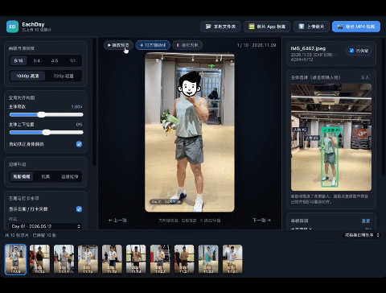

<div align="center">

# EachDay (Match-Still)

**Automatically align yourself across daily gym progress photos and turn them into smooth timelapse videos.**

[](LICENSE)
[](https://semico.github.io/Match-Still/)
[](https://www.python.org/)

English | [简体中文](README.zh-CN.md)

</div>

---

> ### 🌐 Try It Instantly in Your Browser — 100% Local & Private
> **[Open Match-Still Web Studio →](https://semico.github.io/Match-Still/)**
>
> **Zero uploads. Zero backend.** AI pose detection (`YOLO11-Pose` via ONNX Runtime Web), subject locking, alignment, and MP4 encoding all run **100% locally inside your browser**. Your photos never leave your device—you can even disconnect Wi-Fi after loading the page.

Take a mirror selfie after every workout? **EachDay** detects your body pose across all your photos, filters out random gym-goers in the background, aligns your head, shoulders, and torso to the exact same scale and position, and exports a crisp H.264 MP4 timelapse—all running **100% locally** on your machine.

<p align="center">
  
</p>

## Features

- **Multi-Person Pose Detection + Subject Locking (`YOLO11-Pose`)**  
  Detects every person in the frame and automatically locks onto *you* using foreground prominence, upright posture cues, and cross-photo head appearance matching—even when people walk or bend over right behind you in the gym.
- **Self-Calibrating Body Alignment**  
  Learns your natural shoulder-to-torso and head-to-torso proportions across the entire batch, aligns every frame smoothly regardless of distance to the mirror, and levels tilt relative to your natural standing posture so gym walls stay straight.
- **Natural Gaussian Blur Edge Fill**  
  When zooming or shifting exposes areas outside the original photo, EachDay blends a softly feathered Gaussian-blurred background instead of harsh black bars (with optional `black` or `edge` modes).
- **EXIF Chronological Sorting & Watermarks**  
  Supports `JPG`, `PNG`, `WEBP`, and iPhone `HEIC/HEIF`. Automatically sorts by EXIF capture date and renders optional frosted pill watermarks like `Day 01 · 2026.05.12`.
- **Interactive Local Web Studio**  
  - Import from a **local folder**, **drag-and-drop upload**, or directly from a **macOS Photos album**
  - **Onion-skin overlay** (`O`) & **alignment guides** (`G`) to inspect frame-to-frame precision
  - **Live playback preview** (`Space`) before exporting
  - **One-click subject switching** on the original photo if a crowded shot ever picks someone else
  - **Drag / scroll fine-tuning** and instant frame skip (`X`)
- **Zero-Setup H.264 MP4 Export**  
  Uses bundled `imageio-ffmpeg` (no separate FFmpeg install needed) with `9:16`, `3:4`, `4:5`, and `1:1` aspect ratios, `1080p` / `720p`, configurable FPS, final-frame hold, and optional crossfade transitions.

## Installation

Requires **Python 3.10–3.12** and [`uv`](https://docs.astral.sh/uv/).

```bash
git clone https://github.com/semico/Match-Still.git
cd Match-Still
uv sync --python 3.10
```

> On first run, the lightweight `yolo11n-pose.pt` (~6 MB) pose model is automatically downloaded into `models/` and cached for offline use.

## Quick Start

### 1. Launch the Local Web Studio (Recommended)

```bash
uv run eachday
```

This starts the local studio at `http://127.0.0.1:8765` and opens it in your browser automatically.

You can also pre-load a folder on startup:

```bash
uv run eachday --folder ~/Pictures/Gym
```

### 2. Headless CLI Mode (Optional)

Run full auto-alignment and video export directly from the terminal without opening the browser:

```bash
uv run eachday --headless \
  --folder ~/Pictures/Gym \
  --output gym_progress.mp4 \
  --aspect 9:16 \
  --resolution 1080p \
  --fps 6
```

<details>
<summary>All CLI options</summary>

| Flag | Default | Description |
| --- | --- | --- |
| `-f, --folder` | — | Path to a local photo folder to load |
| `-r, --recursive` | `false` | Recursively scan subfolders |
| `-p, --port` | `8765` | Local web server port |
| `--no-browser` | `false` | Start the web server without auto-opening the browser |
| `--headless` | `false` | Skip web UI and export video directly |
| `-o, --output` | auto | Output `.mp4` path (headless mode) |
| `--aspect` | `9:16` | Aspect ratio: `9:16`, `3:4`, `4:5`, `1:1` |
| `--resolution` | `1080p` | Output resolution: `1080p`, `720p` |
| `--fps` | `6.0` | Photos per second |
| `--fill` | `blur` | Edge fill mode: `blur`, `black`, `edge` |
| `--no-watermark` | `false` | Disable date/day watermark overlay |
| `--crossfade` | `false` | Enable smooth crossfade between consecutive photos |

</details>

## Studio Keyboard Shortcuts

| Shortcut | Action |
| --- | --- |
| `←` / `→` | Previous / Next photo |
| `Space` | Play / Pause live timelapse preview |
| `G` | Toggle alignment guide lines |
| `O` | Toggle onion-skin overlay (compare with previous frame) |
| `X` | Include / Skip current frame |
| Drag / Scroll on preview | Fine-tune current frame position & zoom |

## macOS Photos App Import

Click **照片 App 相簿 (Photos Albums)** in the studio header to browse albums directly from the macOS Photos app and export originals with EXIF dates intact. On first use, macOS will ask for Automation permission to access Photos.

> Tip: Create a dedicated album (e.g., `Gym`) in macOS Photos and drop your post-workout photos into it for one-click imports.

## Privacy

All pose detection, image processing, and video encoding run **100% locally** on your computer. Your photos are never uploaded to any external server.

## License

Released under the [MIT License](LICENSE). Copyright © 2026 Yubo.
