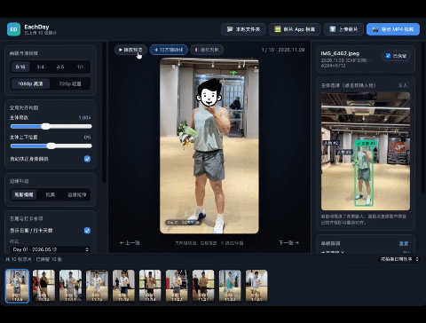

<div align="center">

# EachDay

**自动对齐每次健身打卡照片中的人物主体，一键生成流畅的高清成长延时视频。**

[](LICENSE)
[](https://semico.github.io/Each-Day/)
[](https://www.python.org/)

[English](README.md) | 简体中文

</div>

---

> ### 🌐 打开网页直接用 — 100% 本地运行 · 照片绝不上传
> **[立即打开 EachDay 网页工作台 →](https://semico.github.io/Each-Day/)**
>
> **零上传 · 无后端服务器。** AI 姿态识别（浏览器本地运行 `YOLO11-Pose ONNX`）、人物锁定、图像对齐与 MP4 视频编码全部在你的本机浏览器内完成，照片永远不会离开你的设备（加载完页面后甚至可以断网使用）。

每次练完都会对镜自拍打卡？**EachDay** 自动识别并对齐每张照片中的「你」，智能过滤健身房背景里的路人，把远近不一、角度微偏的照片稳稳对齐到同一位置与比例，并导出流畅的 H.264 MP4 延时视频——全程 **100% 本地运行**，保护个人隐私。

<p align="center">
  
</p>

## 核心特性

- **多人体姿态识别 + 主体锁定（`YOLO11-Pose`）**  
  检测画面中的所有人并结合前景比例、直立姿态和跨照片头部外观特征自动锁定「你」，即使健身房背景里有他人走动、弯腰或路过也能准确过滤。
- **自适应身体比例对齐**  
  自动校准整批照片中你的自然肩宽/躯干比例与单手握机习惯，按头部、双肩/颈部和髋部联合对齐，让站远站近的照片人物位置稳如泰山，同时保持背景门窗水平不歪斜。
- **自然高斯模糊补边**  
  对齐后若边缘超出原图范围，自动采用带羽化过渡的高斯模糊背景自然补边，告别突兀黑边（也可切换纯黑或边缘拉伸）。
- **EXIF 拍摄日期排序 + 打卡水印**  
  原生支持 iPhone `HEIC/HEIF`、`JPG`、`PNG`、`WEBP`，自动按 EXIF 拍摄时间排序，并叠加如 `Day 01 · 2026.05.12` 的磨砂胶囊水印（支持自定义样式、位置或关闭）。
- **本地交互式对齐工作台**  
  - 支持 **本地文件夹**、**网页拖拽上传**、**macOS「照片」App 相簿** 三种导入方式
  - 内置 **叠影对照（`O`）** 与 **对齐辅助线（`G`）**，一眼核对帧间对齐精度
  - **实时播放预览（`Space`）**，导出前直接预览成片节奏
  - 多人照片支持在原图方框上 **一键点击切换主体**
  - 支持预览画面 **直接拖拽/滚轮微调** 与一键跳过异常帧（`X`）
- **开箱即用的高清 MP4 导出**  
  内置 `imageio-ffmpeg`（无需额外安装 FFmpeg），支持 `9:16`、`3:4`、`4:5`、`1:1` 画幅、`1080p`/`720p` 清晰度、自定义切换速度、末帧停留与淡入淡出过渡。

## 安装

需要 **Python 3.10–3.12** 和 [`uv`](https://docs.astral.sh/uv/)：

```bash
git clone https://github.com/semico/Each-Day.git
cd Each-Day
uv sync --python 3.10
```

> 首次运行时会自动下载轻量的 `yolo11n-pose.pt`（约 6 MB）到 `models/` 目录，之后即可完全离线使用。

## 快速开始

### 1. 启动本地网页工作台（推荐）

```bash
uv run eachday
```

程序会自动启动本地工作台并在浏览器打开（默认 `http://127.0.0.1:8765`）。

也可以启动时直接加载指定照片文件夹：

```bash
uv run eachday --folder ~/Pictures/Gym
```

### 2. 纯命令行模式（可选）

不打开浏览器，直接全自动对齐并导出视频：

```bash
uv run eachday --headless \
  --folder ~/Pictures/Gym \
  --output gym_progress.mp4 \
  --aspect 9:16 \
  --resolution 1080p \
  --fps 6
```

## 网页工作台快捷键

| 快捷键 | 功能 |
| --- | --- |
| `←` / `→` | 切换上一张 / 下一张照片 |
| `Space` | 播放 / 暂停实时对齐预览 |
| `G` | 开关对齐辅助线 |
| `O` | 开关叠影对照（叠加前一张对齐结果对比） |
| `X` | 保留 / 跳过当前照片 |
| 预览图上拖拽 / 滚轮 | 手动微调当前照片的位置和缩放 |

## macOS「照片」App 相簿导入

点击顶部「照片 App 相簿」即可直接读取你在「照片」中整理的自定义相簿并导出原图（保留完整 EXIF 拍摄时间）。首次使用时，在系统弹窗中允许自动化访问「照片」即可。

> 小技巧：在「照片」App 里建一个「健身打卡」相簿，平时拍完直接加入相簿，之后打开工具一键导入即可。

## 隐私说明

所有姿态识别、图像对齐与视频编码均 **100% 在本地运行**，照片不会上传至任何外部服务器。

## 开源协议

基于 [MIT License](LICENSE) 开源。Copyright © 2026 Yubo.
